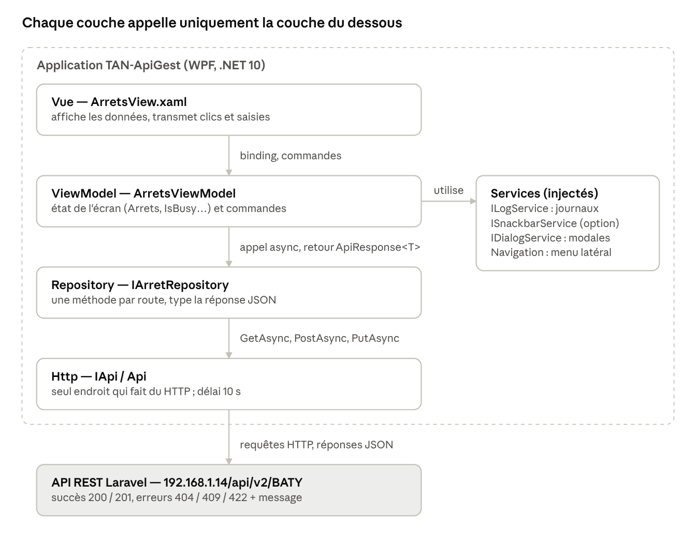

# TAN-ApiGest — Cahier des charges

31 octobre 2026 · Xavier Baty

## 1. Contexte

Nantes Métropole veut une application de bureau qui permette aux agents de saisir eux-mêmes les changements du réseau TAN (arrêts, lignes, horaires…) liés aux travaux, sans mobiliser un informaticien. Ce cahier des charges décrit la première maquette, **TAN-ApiGest**.

Le réseau des transports en commun de l'agglomération nantaise, simplifié en réseau TAN, dessert Nantes, 23 communes de la métropole et la commune du Cellier. Il compte :

- 3 lignes de tramway ;
- 2 lignes de Busway (bus à haut niveau de service) ;
- 8 lignes Chronobus et 49 lignes de bus régulières ;
- 4 lignes nocturnes Luciole ;
- 4 services de transport à la demande ;
- des lignes et circuits scolaires ;
- 3 lignes Navibus (liaisons fluviales).

Nantes Métropole, autorité organisatrice des transports, en délègue la gestion à la SEMITAN (Société d'économie mixte des transports en commun de l'agglomération nantaise). La métropole publie aussi ses données sur une plateforme d'open data commune, ouverte aux citoyens, associations, entreprises et collectivités ; les données de transport en commun y figurent.

**Votre situation.** Jeune stagiaire au service informatique de Nantes Métropole, votre responsable, la diabolique Lucie Faire, vous demande de réaliser cette maquette. Son adjoint, M. Bâty, passe régulièrement vérifier et évaluer votre avancement.

**L'API.** L'API officielle de la TAN (désormais Naolib) est en accès libre, mais trop de connexions risqueraient de la perturber. Vous travaillez donc sur une **copie** de cette API, en accès libre elle aussi, sans authentification ni jeton, dans sa **version 2** : `http://192.168.1.14/api/v2/{identifiant}/`. Chaque élève reçoit un identifiant (par exemple `BATY`, lettres et chiffres uniquement) et travaille sur sa propre copie des données : ses ajouts et modifications ne touchent pas celles des autres, et il peut les remettre à zéro à tout moment. La V2 répond avec des codes HTTP classiques (200, 201, 404, 409, 422) et des erreurs au format JSON.

Cette API n'est pas forcément écrite dans les règles de l'art, en particulier pour le nommage des champs JSON. C'est un fait dont il faut tenir compte : à vous de vous adapter ([personnaliser les noms de propriétés avec System.Text.Json](https://learn.microsoft.com/fr-fr/dotnet/standard/serialization/system-text-json/customize-properties?pivots=dotnet-6-0#customize-individual-property-names)).

## 2. Périmètre et livrables

La maquette lit et modifie les arrêts et leurs lignes via l'API V2 ; les horaires sont hors périmètre. On peut renommer un arrêt et lui ajouter une ligne, mais **pas** modifier un code d'arrêt ou de ligne : ces codes servent d'identifiants.

Deux fonctionnalités sont **optionnelles** et valorisées en bonus : la recherche dans la liste des arrêts et les messages de type Snackbar (Material Design). Sans elles, l'application reste complète : les erreurs sont alors affichées dans une zone de message de l'écran.

| Livrable | Contenu attendu |
| --- | --- |
| Application **TAN-ApiGest** | Solution Visual Studio C# / WPF, interface MaterialDesignInXAML sur le modèle d'AliPurchase |
| Dépôt Git **TAN-ApiGest** | Sur votre GitLab, un commit par étape, un tag par version ; bibliothèques non versionnées (`bin/`, `obj/`, paquets NuGet exclus par le `.gitignore`) |
| Collection **Bruno** | Dossier `bruno/` du dépôt : une requête par route utilisée, avec tests, validée par M. Bâty avant tout code C# |
| **README.md** | Installation, configuration de l'URL de l'API, routes, correspondance JSON → C#, architecture, historique des versions |

## 3. User stories

L'utilisateur est un **agent du service transports** de Nantes Métropole, sans compétence informatique particulière. Huit user stories sont obligatoires, deux sont optionnelles (bonus).

| ID | En tant qu'agent, je veux… | …afin de… | Fonct. | Priorité |
| --- | --- | --- | --- | --- |
| US1 | naviguer entre les écrans par un menu latéral | trouver chaque fonction au même endroit que dans les autres applications du service | — | Obligatoire |
| US2 | voir la liste de tous les arrêts gérés par la TAN | connaître l'état actuel du réseau | F1 | Obligatoire |
| US3 | actualiser la liste | voir les données les plus récentes de l'API | F1 | Obligatoire |
| US4 | voir les codes des lignes qui desservent un arrêt | savoir quelles lignes sont concernées par un chantier | F2 | Obligatoire |
| US5 | corriger le nom d'un arrêt directement dans la liste | tenir compte d'un changement de nom sans passer par un informaticien | F4 | Obligatoire |
| US6 | remettre les données dans leur état initial | repartir d'une base propre après des essais | — | Obligatoire |
| US7 | ajouter une ligne à un arrêt | signaler une déviation qui fait passer une ligne par cet arrêt | F3 | Obligatoire |
| US8 | être averti quand une action échoue, avec sa cause | corriger la saisie ou réessayer en connaissance de cause | — | Obligatoire |
| US9 | rechercher un arrêt par son nom, son code ou une ligne | trouver un arrêt parmi plus de 1 100 | F1 | Optionnelle |
| US10 | recevoir une confirmation brève et colorée de chaque action | savoir d'un coup d'œil si tout s'est bien passé | — | Optionnelle |

### Critères d'acceptation

**US1 — Navigation**

- Un bouton ☰ ouvre un menu latéral avec les entrées **Accueil** et **Arrêts**, chacune avec une icône.
- Au démarrage, l'écran d'accueil s'affiche ; il indique l'adresse de l'API interrogée.
- Choisir une entrée affiche l'écran correspondant et referme le menu.

**US2 — Liste des arrêts**

- La liste se charge automatiquement à l'ouverture de l'écran Arrêts (`GET /arrets`, réponse 200).
- Une grille affiche le code et le nom de chaque arrêt, triés par nom.
- Une barre de progression est visible pendant le chargement.

**US3 — Actualisation**

- Un bouton **Actualiser** recharge la liste depuis l'API.
- Il est désactivé pendant un chargement, pour éviter les doubles appels.

**US4 — Lignes d'un arrêt**

- Sélectionner un arrêt affiche, à droite, son nom, son code, son nombre de lignes et une grille des codes de ligne.
- Sans sélection, un message invite à choisir un arrêt ; un arrêt sans ligne affiche « Aucune ligne ne dessert actuellement cet arrêt ».
- Aucun appel supplémentaire à l'API : les lignes sont déjà dans la réponse de la liste.

**US5 — Renommer un arrêt**

- Un double-clic sur le nom le rend modifiable ; le code reste en lecture seule.
- Valider (Entrée ou clic ailleurs) envoie le nom à l'API (`PUT`, réponse 200 avec l'arrêt enregistré) ; la grille affiche le nom renvoyé par l'API.
- Nom inchangé : aucun appel. Nom vide (422) ou arrêt introuvable (404) : l'ancien nom revient et la cause est affichée (US8).

**US6 — Réinitialiser**

- Un bouton **Réinitialiser**, à côté d'**Actualiser**, remet les données de l'API dans leur état initial (`GET /reset`).
- L'API renvoie la liste réinitialisée (200) : la grille l'affiche directement, sans second appel.

**US7 — Ajouter une ligne**

- Chaque arrêt de la grille porte un bouton **Ajouter Ligne**, qui sélectionne aussi cet arrêt.
- Une fenêtre modale rappelle l'arrêt et demande le code de la ligne ; **Enregistrer** est grisé tant que le champ est vide, **Annuler** ferme sans rien faire.
- Le code est mis en majuscules. S'il dessert déjà l'arrêt, l'application le signale sans appeler l'API.
- L'API répond 201 avec la ligne créée : la grille des lignes et le compteur se mettent à jour sans recharger la liste.

**US8 — Messages d'erreur**

- Toute erreur de l'API (404, 409, 422) affiche le `message` qu'elle renvoie, par exemple « Arrêt ZZZZ introuvable. ».
- Serveur injoignable, délai dépassé (10 s) ou réponse invalide donnent un message clair, jamais un plantage.
- Le message s'affiche dans une zone dédiée de l'écran (propriété `ErrorMessage` du ViewModel) et s'efface à l'action réussie suivante.
- Quitter l'écran pendant un chargement annule la requête sans message.

**US9 — Recherche (optionnelle)**

- La saisie filtre la liste sans nouvel appel à l'API ; elle ignore majuscules et accents : « precheurs » trouve « Prêcheurs ».
- Un code de ligne exact (« C6 ») affiche les arrêts de cette ligne.
- Un compteur indique « N arrêt(s) affiché(s) sur M ».

**US10 — Messages Snackbar (optionnelle)**

- Chaque action terminée affiche un message bref en bas de la fenêtre (Snackbar Material Design) : vert en cas de succès (« 1 165 arrêts chargés », « Ligne C6 ajoutée »), rouge en cas d'erreur.
- Le Snackbar peut remplacer la zone d'erreur de l'US8 ; le contenu des messages d'erreur reste le même.

## 4. Spécifications techniques

L'application reprend l'architecture d'AliPurchase : MVVM, injection de dépendances, couches HTTP / Repository / Service, Material Design. Tout ce qui existe dans AliPurchase est réutilisé tel quel, sauf l'authentification, inutile ici.

### 4.1 Environnement

- C# / WPF, cible `net10.0-windows` (même version de .NET qu'AliPurchase), solution au format `.slnx`.
- Visual Studio 2022 17.14 ou plus, ou Visual Studio 2026.
- Projet `TAN-ApiGest`, espace de noms racine `TanApiGest` (le tiret est interdit dans un espace de noms C#).
- Configuration dans une seule classe, `Properties/AppSettings.cs` : `API_URL = "http://192.168.1.14/api/v2"` et `API_SPACE = "/BATY"` (l'identifiant de l'élève). Routes dans `Http/ApiEndpoints.cs` : aucune URL écrite en dur ailleurs.

### 4.2 Paquets NuGet

Mêmes paquets et mêmes versions qu'AliPurchase, restaurés automatiquement, jamais versionnés.

| Paquet | Version | Rôle |
| --- | --- | --- |
| MaterialDesignThemes, MaterialDesignColors | 5.3.2 | Thème Material Design 3, menu latéral, DialogHost, icônes ; Snackbar (option US10) |
| CommunityToolkit.Mvvm | 8.4.2 | `ObservableObject`, `[ObservableProperty]`, `[RelayCommand]` |
| Microsoft.Extensions.DependencyInjection | 10.0.9 | Conteneur d'injection de dépendances |
| Microsoft.Xaml.Behaviors.Wpf | 1.1.135 | Événements XAML vers commandes (`Loaded`, `CellEditEnding`) |
| Serilog, Serilog.Sinks.File, Serilog.Sinks.Debug | 4.3.1 / 7.0.0 / 3.0.0 | Journaux dans un fichier par jour et dans Visual Studio |

### 4.3 Architecture MVVM

Chaque couche ne connaît que la couche du dessous, et seulement par son interface.

| Dossier | Contenu | Règle |
| --- | --- | --- |
| `Views/` | `MainWindow`, `HomeView`, `ArretsView`, `Dialogs/AddLigneDialog`, composant de menu | XAML + code-behind limité à `DataContext` et à l'annulation au déchargement |
| `ViewModels/` | `MainWindowViewModel`, `HomeViewModel`, `ArretsViewModel`, `Dialogs/AddLigneDialogViewModel` | État de l'écran (dont `ErrorMessage`) + commandes ; aucune référence à un contrôle WPF |
| `Models/` | `Arret`, `Ligne` | Correspondance avec le JSON de l'API |
| `Repositories/` | `IArretRepository` / `ArretRepository` | Une méthode par route : construit la requête et type la réponse |
| `Http/` | `IApi` / `Api`, `ApiEndpoints` | Seul endroit qui fait du HTTP : `GetAsync`, `PostAsync`, `PutAsync` ; lit le code HTTP et le message d'erreur |
| `Services/` | Journalisation, navigation interne, dialogues ; Snackbar (option US10) | Services transverses, tous derrière une interface |
| `DTOs/` | `ApiResponse<T>`, `ApiErrorResponse`, `AddLigneDialogResult` | Objets d'échange entre couches |



Le conteneur d'injection de dépendances (`App.xaml.cs`) crée chaque couche et lui fournit celle du dessous ; toutes les fonctionnalités passent par cette même chaîne.

### 4.4 Injection de dépendances

Tout est déclaré dans `App.xaml.cs` ; aucune classe ne fait `new` sur un service, un repository ou un ViewModel.

| Durée de vie | Classes | Pourquoi |
| --- | --- | --- |
| Singleton | `IApi`, `ILogService`, `IMainWindowNavigationService`, `IDialogService`, `IArretRepository` ; `ISnackbarService` si l'option US10 est réalisée | Un seul `HttpClient`, un seul état de navigation, une seule file de messages |
| Transient | ViewModels, vues, fenêtre principale, dialogue | Un écran neuf à chaque navigation |

Les vues navigables (`Register<HomeViewModel, HomeView>()`…) et les dialogues (`Register<AddLigneDialogViewModel, AddLigneDialog>()`) sont enregistrés au démarrage, comme dans AliPurchase.

### 4.5 API V2 et correspondance JSON

Toutes les routes sont préfixées par `http://192.168.1.14/api/v2/{identifiant}` (par exemple `BATY`). Le succès se lit dans le **code HTTP** ; en cas d'erreur, le corps est toujours du JSON : `{ "message": "Arrêt ZZZZ introuvable." }`.

| Verbe | Route | Corps envoyé | Succès | Erreurs | Utilisée par |
| --- | --- | --- | --- | --- | --- |
| GET | `/arrets` | — | 200 + tableau des arrêts | — | US2 à US4 |
| GET | `/reset` | — | 200 + tableau réinitialisé | — | US6 |
| PUT | `/{codeLieu}/arret` | `{ "libelle": "…" }` | 200 + l'arrêt modifié | 404 arrêt introuvable · 422 nom vide | US5 |
| POST | `/{codeLieu}/arret` | `{ "numLigne": "C6" }` | 201 + la ligne ajoutée | 404 arrêt introuvable · 409 ligne déjà présente · 422 code vide | US7 |

Un identifiant qui contient autre chose que des lettres et des chiffres reçoit une 404. L'ancienne version de l'API (`api/{identifiant}/…`, réponses `true` / `false` toujours en 200) reste en ligne mais n'est pas utilisée.

Un arrêt dans la réponse de `/arrets` :

```json
{ "codeLieu": "COMM", "libelle": "Commerce", "distance": null,
  "ligne": [ { "numLigne": "1" }, { "numLigne": "2" }, { "numLigne": "3" } ] }
```

Les noms JSON ne suivent pas les conventions C# : on garde des propriétés C# conventionnelles et on indique le nom JSON avec `[JsonPropertyName]`.

| Champ JSON | Propriété C# | Type |
| --- | --- | --- |
| `codeLieu` | `Arret.CodeLieu` | `string` |
| `libelle` | `Arret.Libelle` | `string`, notifie la vue (modifiable) |
| `ligne` (au singulier, mais un tableau) | `Arret.Lignes` | `ObservableCollection<Ligne>` |
| `numLigne` | `Ligne.NumLigne` | `string` (codes alphanumériques : `C6`) |
| `distance` | non repris | toujours `null` dans la liste |
| `message` (réponse d'erreur) | `ApiErrorResponse.Message` | `string` |

### 4.6 Robustesse et messages d'erreur

- Aucune exception réseau ne remonte aux ViewModels : `Api` renvoie un `ApiResponse<T>` (succès + données, ou message d'erreur).
- Réponse 2xx : `Api` désérialise le corps dans le type attendu. Autre code : `Api` lit le champ `message` de la réponse (`ApiErrorResponse`) et le transmet tel quel ; à défaut, « Erreur serveur (code) ».
- Le repository ne réinterprète rien : le succès ou l'échec vient du code HTTP.
- Cas distingués côté client : serveur injoignable, JSON invalide, délai dépassé (10 s), annulation volontaire.
- Affichage obligatoire : propriété `ErrorMessage` du ViewModel, liée à une zone de texte de la vue. Option US10 : le Snackbar affiche ces mêmes messages, plus les confirmations de succès.
- Chaque opération longue utilise un `CancellationToken`, annulé quand la vue est déchargée ; la propriété `IsBusy` affiche la barre de progression et désactive les commandes pendant un appel.
- Serilog : fichier `logs/tan-apigest_AAAAMMJJ.log` à côté de l'exécutable ; trois gestionnaires globaux d'exceptions (thread UI, hors thread UI, tâches non observées).

### 4.7 Normes de code

- PascalCase pour types, propriétés et méthodes ; `_camelCase` pour les champs privés ; suffixe `Async` pour les méthodes asynchrones ; préfixe `I` pour les interfaces.
- Noms métier en français (`Arret`, `Ligne`, `Libelle`), noms techniques en anglais (`Repository`, `ViewModel`, `LoadArretsCommand`), comme AliPurchase.
- Un type par fichier ; commentaire `/// <summary>` sur chaque classe et membre public, en français.
- Propriétés observables par `[ObservableProperty]` (propriétés `partial`), commandes par `[RelayCommand]`.

### 4.8 Versionnage

- `.gitignore` en place avant le premier commit : `bin/`, `obj/`, `.vs/`, `*.user`, `packages/`, `logs/`.
- Un commit par étape, message en français qui dit ce qui change et pourquoi.
- Une branche par fonctionnalité d'écriture (`F3-ajout-ligne-arret`…), fusionnée dans `main` une fois testée.
- Un tag par version livrée : `v0.1`, `v0.2`…

## 5. Découpage en étapes

Le travail obligatoire tient en huit étapes, de l'installation à la livraison ; deux étapes optionnelles viennent ensuite. Chaque étape laisse l'application compilable et testable (F5), et se termine par un commit.

### Étape 0 — Mise en place du projet et du dépôt

**Objectif :** une solution vide qui compile, déjà versionnée.

- Créer le projet WPF `TAN-ApiGest` (espace de noms `TanApiGest`) et ajouter les paquets NuGet du § 4.2.
- Créer le dépôt `TAN-ApiGest` sur GitLab ; ajouter le `.gitignore` **avant** le premier commit.
- Brancher le thème Material Design 3 dans `App.xaml`, comme dans AliPurchase.

**À tester :** la fenêtre s'ouvre ; `git status` ne montre ni `bin/` ni `obj/`.

### Étape 1 — Test des routes avec Bruno

**Objectif :** connaître le format réel des réponses et des erreurs avant d'écrire la moindre classe C#.

- Créer la collection `bruno/` dans le dépôt, avec un environnement à votre identifiant (`baseUrl = http://192.168.1.14/api/v2/BATY`).
- **01 - Liste des arrêts** (`GET /arrets`) : statut 200 ; la réponse est un tableau non vide ; chaque arrêt a un `codeLieu`, un `libelle` et un tableau `ligne` ; chaque ligne a un `numLigne`.
- **02 - Reset des données** (`GET /reset`) : statut 200, la réponse est la liste réinitialisée.
- **05 - Erreur : arrêt introuvable** (`PUT /ZZZZ/arret`) : statut 404 et corps JSON `{ "message": "Arrêt ZZZZ introuvable." }`.
- Noter les noms de champs « hors normes » à adapter en C# (§ 4.5).

**À valider :** par M. Bâty, avant l'étape 3. Les requêtes 03 (POST) et 04 (PUT) sont ajoutées avec leur étape.

### Étape 2 — Interface avec menu seule (US1)

**Objectif :** la coque de l'application, sans données.

- `App.xaml.cs` : Serilog, les trois gestionnaires globaux d'exceptions, le conteneur DI.
- Services : `ILogService` et `IMainWindowNavigationService`, repris d'AliPurchase.
- `MainWindow` : `DrawerHost` (menu latéral), barre de titre `ColorZone`, `ContentControl` pour la vue courante.
- Menu : `MainMenuItemNavigation` (ViewModel) + composant graphique `IconAndTextMenuItem` ; entrée **Accueil** seule.
- `HomeView` : message d'accueil et adresse de l'API.

**À tester :** le bouton ☰ ouvre le menu ; l'accueil s'affiche au démarrage.

### Étape 3 — Liste des arrêts, bouton Actualiser, mise à jour de la vue (US2, US3, US8)

**Objectif :** F1, la lecture des arrêts, avec des erreurs affichées proprement.

- Couche HTTP : `AppSettings`, `ApiEndpoints.Arrets.GetAll`, `IApi` / `Api` avec `GetAsync<T>`, `ApiResponse<T>`, délai de 10 s.
- Erreurs : en cas de code autre que 2xx, `Api` lit le `message` de la réponse via `ApiErrorResponse` et le renvoie dans `ApiResponse.ErrorMessage`.
- Modèles `Arret` et `Ligne` avec `[JsonPropertyName]` ; `IArretRepository.GetAllAsync`.
- `ArretsViewModel` : `Arrets`, `IsBusy`, `ErrorMessage`, `LoadArretsCommand` (tri par nom, `CancellationToken`).
- `ArretsView` : grille Code / Arrêt, chargement sur `Loaded`, bouton **Actualiser**, barre de progression, zone de message d'erreur ; entrée **Arrêts** dans le menu.

**À tester :** la liste s'affiche triée ; avec l'API arrêtée ou une URL fausse, un message d'erreur apparaît et l'application ne plante pas ; Actualiser est grisé pendant le chargement.

### Étape 4 — Liste des arrêts éditable, bouton Réinitialiser, mise à jour de la vue (US5, US6)

**Objectif :** F4, renommer un arrêt, et pouvoir revenir aux données d'origine.

- Bruno : requête **04 - Modifier le nom d'un arrêt** (`PUT /{codeLieu}/arret`) : statut 200, la réponse est l'arrêt avec son nouveau nom.
- `IApi.PutAsync<T>` ; `ApiEndpoints.Arrets.Update` et `ApiEndpoints.Data.Reset`.
- Repository : `UpdateLibelleAsync` renvoie l'arrêt enregistré (`ApiResponse<Arret>`), `ResetAsync` la liste réinitialisée (`ApiResponse<Collection<Arret>>`).
- `Arret` dérive de `ObservableObject` : `Libelle` notifie la vue ; `OriginalLibelle` mémorise le nom enregistré dans l'API, avec `AcceptLibelle()` et `RevertLibelle()`. Voir l'aide « Mémoriser le nom d'origine d'un arrêt » ci-dessous.
- Grille : colonne Arrêt éditable (`UpdateSourceTrigger=PropertyChanged`), Code en lecture seule ; `CellEditEnding` → `UpdateLibelleCommand` avec l'arrêt sélectionné, comme `UpdateCategoryNameCommand` dans AliPurchase.
- Bouton **Réinitialiser** à côté d'Actualiser : `ResetCommand` appelle `/reset` et affiche directement la liste renvoyée.

**À tester :** renommer un arrêt, actualiser : le nouveau nom reste ; vider un nom : l'ancien revient avec un message ; Réinitialiser : les noms d'origine reviennent, en un seul appel (vérifier dans le journal).

#### Aide — Mémoriser le nom d'origine d'un arrêt

> **Notion — Pourquoi garder l'ancien nom ?** Avec `UpdateSourceTrigger=PropertyChanged`, la propriété `Libelle` reçoit le nouveau nom à chaque frappe : quand la cellule se ferme, l'ancien nom a disparu. On en a pourtant besoin dans deux cas : si le nom n'a pas changé, on n'appelle pas l'API ; si l'API refuse ou ne répond pas, on remet l'ancien nom à l'écran, car la grille doit montrer ce qui est réellement enregistré. On ajoute donc à `Arret` une propriété `OriginalLibelle`, qui garde le nom tel qu'il est enregistré dans l'API.

**1. Dans `Models/Arret.cs`**, ajoutez la propriété et deux méthodes :

```csharp
/// <summary>
/// Nom tel qu'il est enregistré dans l'API. Il ne vient pas du JSON :
/// on le renseigne après chaque chargement et après chaque modification réussie.
/// </summary>
[JsonIgnore]
public string OriginalLibelle { get; private set; } = string.Empty;

/// <summary>Le nom actuel devient le nom de référence (chargement ou modification réussie).</summary>
public void AcceptLibelle() => OriginalLibelle = Libelle;

/// <summary>Remet le nom de référence (modification annulée ou refusée).</summary>
public void RevertLibelle() => Libelle = OriginalLibelle;
```

> **Ce que fait ce code.** `[JsonIgnore]` : cette propriété n'existe pas dans le JSON de l'API, le désérialiseur la laisse vide. `private set` : seules les méthodes d'`Arret` peuvent la modifier. `RevertLibelle()` modifie `Libelle`, qui est une `[ObservableProperty]` : la grille affiche aussitôt l'ancien nom.

**2. Dans `ArretsViewModel`**, initialisez `OriginalLibelle` juste après avoir reçu les arrêts. `LoadArretsAsync` et `ResetAsync` reçoivent toutes les deux une liste d'arrêts : regroupez ce travail dans une seule méthode, appelée par les deux (`DisplayArrets(result.Data);` en cas de succès).

```csharp
/// <summary>
/// Affiche les arrêts reçus de l'API, triés par nom, après avoir mémorisé
/// le nom d'origine de chacun.
/// </summary>
private void DisplayArrets(Collection<Arret>? arrets)
{
    List<Arret> arretsTries = (arrets ?? new Collection<Arret>())
        .OrderBy(arret => arret.Libelle)
        .ToList();

    // Le JSON a rempli Libelle, mais OriginalLibelle est encore vide.
    foreach (Arret arret in arretsTries)
    {
        arret.AcceptLibelle();
    }

    Arrets = new ObservableCollection<Arret>(arretsTries);
}
```

> **Point de vigilance.** Tout arrêt reçu de l'API doit passer par `DisplayArrets`. Sinon son `OriginalLibelle` reste vide, et au premier renommage raté le nom de l'arrêt deviendrait une chaîne vide à l'écran.

**3. Dans `UpdateLibelleAsync`**, utilisez les deux méthodes :

- nom inchangé ou vide : `arret.RevertLibelle();` puis `return;`, sans appel à l'API ;
- réponse en erreur : `arret.RevertLibelle();` puis affichage du message de l'API ;
- succès : `arret.AcceptLibelle();`, le nouveau nom devient la référence.

> **À tester (F5).** Renommer un arrêt puis Actualiser : le nouveau nom est conservé. Effacer un nom puis valider : l'ancien revient avec un message. Arrêter le serveur puis renommer : l'ancien nom revient. Double-cliquer sur un nom puis Entrée sans rien changer : aucune requête dans le journal.

### Étape 5 — Liste des lignes par arrêt (US4)

**Objectif :** F2, voir les lignes de l'arrêt sélectionné.

- `SelectedArret` lié à la sélection de la grille, `HasSelectedArret` pour l'affichage.
- Panneau de droite (`materialDesign:Card`) : nom, code, nombre de lignes (`Lignes.Count`) et une grille en lecture seule des codes de ligne.
- Messages « Sélectionnez un arrêt » et « Aucune ligne… » par `DataTrigger`.

**À tester :** changer de sélection met le panneau à jour sans appel à l'API (vérifier dans le journal).

### Étape 6 — Ajout d'une ligne à un arrêt (US7)

**Objectif :** F3, sur une branche `F3-ajout-ligne-arret`.

- Bruno : requête **03 - Ajout d'une ligne à un arrêt** (`POST /{codeLieu}/arret`) : statut 201 et la ligne créée en réponse ; un second envoi donne 409.
- `IApi.PostAsync<T>` ; `ApiEndpoints.Arrets.AddLigne` ; `AddLigneAsync` dans le repository, qui renvoie la ligne créée (`ApiResponse<Ligne>`).
- `Arret.Lignes` devient une `ObservableCollection<Ligne>` : la grille de droite se met à jour seule après un ajout.
- Dialogue sur le modèle de l'ajout de catégorie d'AliPurchase : `IDialogService` / `DialogService`, `IDialogResult`, `AddLigneDialogViewModel`, `AddLigneDialogResult`, vue `AddLigneDialog`, `DialogHost Identifier="RootDialog"` dans `ArretsView`.
- Colonne bouton **Ajouter Ligne** (`DataGridTemplateColumn`, commande atteinte par `RelativeSource AncestorType=DataGrid`, arrêt passé en paramètre).

**À tester :** ajouter « C6 » à un arrêt : la grille de droite s'enrichit ; ajouter une ligne déjà présente : message, pas d'appel ; Annuler : rien ne change.

### Étape 7 — Finalisation et livraison

- Compléter le README (§ 2) et relire les commentaires.
- Fusionner la branche dans `main`, poser le tag de version, pousser sur GitLab.
- Démontrer l'application à M. Bâty, collection Bruno à l'appui.

### Étapes optionnelles (bonus)

À réaliser une fois les étapes 0 à 7 terminées, chacune sur sa propre branche.

**Option A — Recherche dans la liste (US9)**

- `ArretsViewModel` garde la liste complète à part et expose la liste filtrée `Arrets`.
- `SearchText` lié à une zone de recherche (`Delay=250`) ; filtre sans casse ni accents (`CompareInfo.IndexOf`), ou par code de ligne exact.
- Compteur `CountLabel` sous la grille.
- **À tester :** « precheurs », « COMM » et « C6 » donnent les résultats attendus ; vider la zone réaffiche tout.

**Option B — Messages Snackbar (US10)**

- `ISnackbarService` / `SnackbarService` repris d'AliPurchase (Singleton, une seule `MessageQueue`).
- `MainWindow` : contrôle `materialDesign:Snackbar` en bas, lié à la `MessageQueue` via `MainWindowViewModel`.
- Les ViewModels appellent `ShowSuccess` / `ShowError` au lieu (ou en plus) de remplir `ErrorMessage`.
- **À tester :** chaque action affiche un message vert ou rouge ; une erreur 404 affiche le message de l'API.

## 6. Critères d'évaluation

Les trois critères du sujet sont évalués par M. Bâty, au fil des étapes puis lors de la démonstration finale ; les options s'ajoutent en bonus.

| Critère | Ce qui est vérifié |
| --- | --- |
| Mise en place de l'application | Projet et paquets conformes au § 4 ; dépôt GitLab `TAN-ApiGest` avec `.gitignore`, sans bibliothèques ; routes testées et validées dans Bruno, codes de retour compris, avant d'être codées |
| Mise en œuvre des fonctionnalités | Critères d'acceptation des user stories obligatoires US1 à US8 (§ 3), étape par étape |
| Qualité du code | Architecture MVVM respectée (aucune logique métier dans le code-behind) ; injection de dépendances ; noms JSON adaptés par `[JsonPropertyName]` ; codes HTTP et messages d'erreur de l'API exploités, sans plantage ; normes et commentaires du § 4.7 ; un commit lisible par étape |
| Bonus | US9 (recherche) et US10 (Snackbar), réalisées sans dégrader les fonctionnalités obligatoires |
